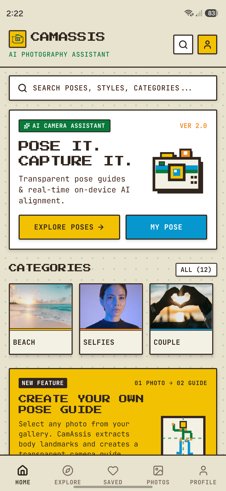
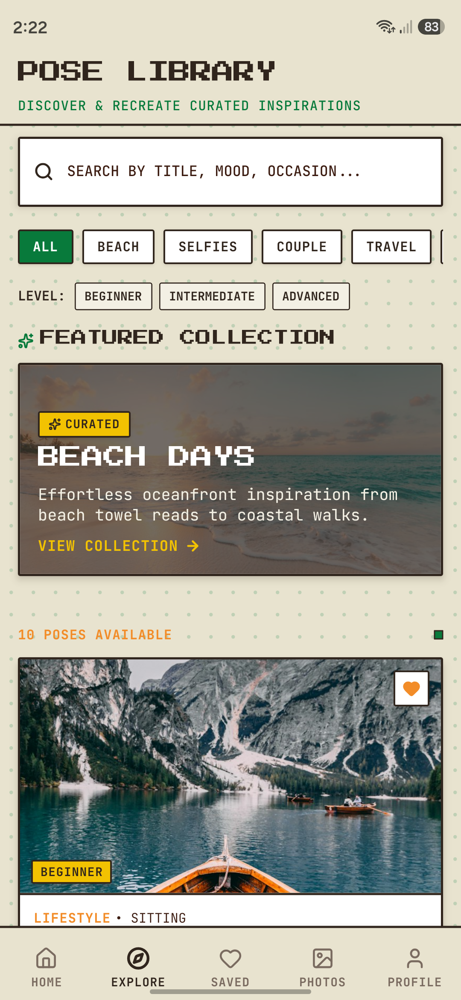
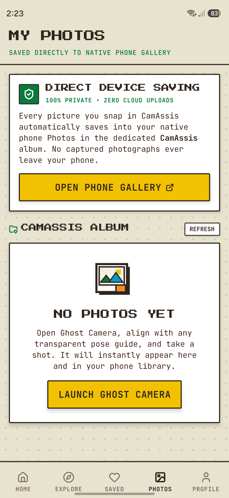
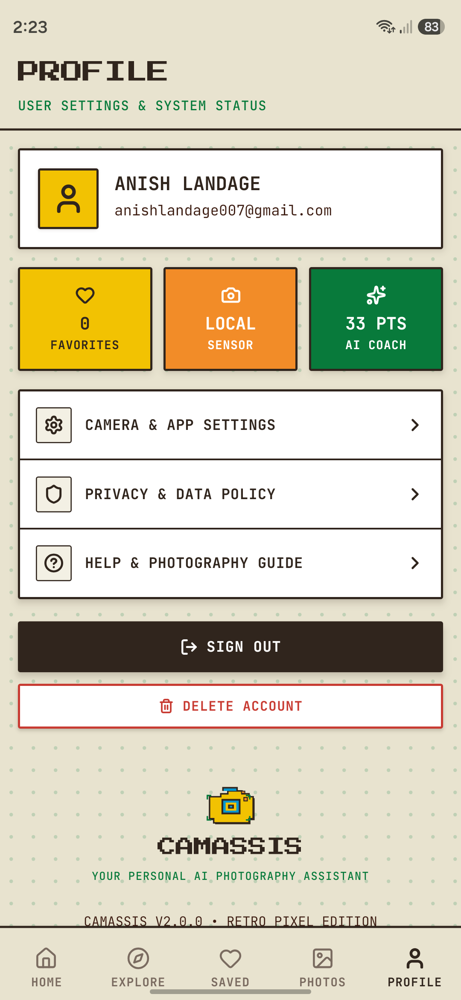

<p align="center">
  
</p>

# CamAssis — AI-Powered Camera & Pose Assistant

> **Your Personal AI Photography Director**  
> *Discover aesthetic poses, align with transparent ghost guides, receive real-time on-device AI posture coaching, and save directly to your native device gallery.*

---

## 🌟 Visual Identity & Design System

CamAssis features a distinctive **retro pixel-art brutalist design system** inspired by modern technical portfolios (such as Life at FlytBase):
- **Warm Cream Canvas**: `#E8E3CF` base background with subtle muted dotted grids.
- **Vibrant Color Blocks**: `#F2C202` (Pixel Yellow), `#F28C28` (Pixel Orange), `#0797CF` (Pixel Blue), and `#087A3B` (Pixel Green).
- **Brutalist Elements**: 2px thick ink borders (`#30251D`), hard offset box-shadows, zero soft blur.
- **Typography**: Short pixel display headers (*Press Start 2P*) paired with legible monospace body (*JetBrains Mono*).
- **Native Status Bar**: Always visible throughout every screen (including live camera view) with dark icons and warm cream background.

---

## 📱 Application UI & Appearance

Real application screenshots captured on a physical Android device showcasing the retro pixel brutalist UI, custom dotted-grid texture, and always-visible native status bar:

| **Home Screen** | **Pose Library** |
| :---: | :---: |
|  |  |
| **Personalized Discovery**<br>Daily pose inspiration, quick category carousels, and one-tap *My Pose* guide creator | **Curated Pose Catalog**<br>Explore 10+ occasions, filter by Beginner/Intermediate/Advanced, and search by mood |

| **My Photos & Local Saving** | **Profile & User Settings** |
| :---: | :---: |
|  |  |
| **Direct Device Saving**<br>100% private, zero cloud photo uploads, and native gallery album integration | **System Status & Preferences**<br>Saved favorites count, AI sensor diagnostics, app settings, and account controls |

---

## 🔒 Privacy-by-Design Guarantee

1. **Zero Cloud Photo Upload**: Photographs captured using CamAssis are immediately saved directly to your native Gallery (Android) or Photos app (iOS) in a dedicated `"CamAssis"` album. No photo pixels are ever uploaded to cloud servers.
2. **On-Device AI Inference**: Body landmark detection, coordinate normalization, and posture similarity run locally on your device. Camera frames are never transmitted over the network.
3. **Pristine Image Output**: The transparent pose overlay and skeleton guides are strictly on-screen preview tools; your captured photographs are pristine native camera sensor captures.

---

## 🚀 Key Features

- **Ghost Pose Camera**: Semi-transparent reference overlay with adjustable opacity (10% - 90%), three view modes (Original Photo, Pose Outline, or Both), 3x3 framing grid, and zoom controls.
- **On-Device AI Pose Coach**: 33-point MediaPipe landmark tracking calculating joint angles across elbows, shoulders, hips, and knees with real-time directional feedback.
- **Curated Pose Library**: Filter poses by Beach, Selfies, Couples, Travel, Sitting, Standing, Candid, and Fashion.
- **My Pose Creator**: Import any image from your camera roll; CamAssis crops, corrects orientation, and extracts a custom transparent pose guide.
- **Hardware-Encrypted Auth**: Session tokens stored securely in iOS Keychain / Android Keystore via `expo-secure-store`.
- **App Store Compliant Account Deletion**: One-click complete account and metadata deletion via Supabase RPC.

---

## 🛠️ Tech Stack

- **Framework**: Expo SDK 58 / React Native 0.88 (TypeScript ~6.0)
- **Routing**: Expo Router (file-system-based routing)
- **State**: Zustand (Local store) & TanStack Query (Server state)
- **Security**: Expo SecureStore (encrypted keychain/keystore)
- **Media**: Expo Camera (`CameraView`), Expo MediaLibrary, Expo ImagePicker
- **Icons**: Lucide React Native

---

## 📋 Quick Start

### 1. Install Dependencies
```bash
npm install
```

### 2. Environment Configuration
Copy `.env.example` to `.env`:
```bash
cp .env.example .env
```
*(If left empty, CamAssis runs in full offline mock mode with bundled categories, collections, and poses).*

### 3. Run Quality Gates
```bash
npm test            # Run automated unit tests (AI normalization, similarity math, data integrity)
npx tsc --noEmit    # TypeScript typechecking (0 errors)
npx expo lint       # ESLint verification (0 warnings, 0 errors)
npx expo-doctor     # Expo dependency and config audit (20/20 checks passed)
```

### 4. Start Development Server
```bash
npx expo start
```

---

## 📚 Documentation

- [docs/ARCHITECTURE.md](docs/ARCHITECTURE.md) — System architecture, subsystems, AI pipeline, and viewport layout.
- [docs/SETUP.md](docs/SETUP.md) — Step-by-step local development & Supabase setup guide.
- [docs/SECURITY.md](docs/SECURITY.md) — Security policies, RLS matrix, and account deletion workflow.
- [docs/RELEASE.md](docs/RELEASE.md) — Build profiles, EAS configuration, and store submission checklists.
- [docs/TESTING.md](docs/TESTING.md) — Testing strategy and device QA verification protocols.
- [docs/STORE_METADATA.md](docs/STORE_METADATA.md) — Ready-to-use Google Play & Apple App Store listing text.
- [docs/LEGAL.md](docs/LEGAL.md) — Production Privacy Policy & Terms of Service.
